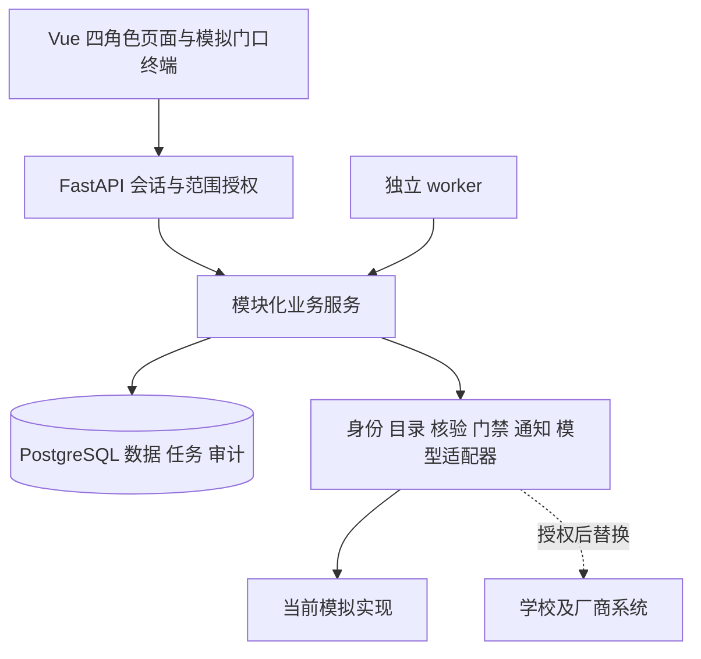

# 技术路线

版本：v1.0；日期：2026-11-15。适用两人开发的 Demo。规则见 [业务规则基线](./业务规则基线.md)，负责人见 [双人协作分工](./双人协作分工.md)。

## 技术选型

| 层 | 选型 | 用途 |
| --- | --- | --- |
| 前端 | Vue 3 + TypeScript + Vite，Vue Router、Pinia | 单工程四角色入口，手机/平板响应式页面 |
| 后端 | Python 3.12 + FastAPI + Pydantic | HTTP API、输入输出校验、学校适配器及 Agent 业务协调 |
| 数据库 | PostgreSQL 17，SQLAlchemy 2 + Alembic | 事务、唯一约束、并发核销、迁移与审计 |
| 后台任务 | 独立 Python worker，共用后端模块，数据库任务表/outbox | 名单、日报周报、风险周期、投递重试、设备对账 |
| 接口 | OpenAPI + JSON Schema；由契约生成 TypeScript 类型/客户端 | 两人统一字段、样例和错误码 |
| 验证 | pytest、前端类型检查与构建、Playwright 关键流程 | 时间、权限、并发、回执及四角色联调 |
| 开发部署 | npm 锁文件、Python 锁文件、Docker Compose | 前端/API/worker/PostgreSQL，环境可复现 |

选择 Vue 的 TypeScript 支持和 FastAPI 的 OpenAPI 能力，目的是让两人共用明确类型与接口。[Vue 官方说明](https://vuejs.org/guide/typescript/overview.html)、[FastAPI 官方说明](https://fastapi.tiangolo.com/features/)。PostgreSQL 用于事务与并发一致性，参考 [官方并发控制文档](https://www.postgresql.org/docs/current/mvcc.html)。

运行基线用 Node.js 22.12 以上的 22.x 环境；初始化时验证所选 Vite 版本兼容性并锁定实际补丁版本，不能让两人各自安装浮动版本。[Vite 环境要求](https://vite.dev/guide/)。Python、PostgreSQL 也在工程初始化记录实际版本。上述为本项目选型，不是学校已有技术栈声明。

暂不引入微服务、Kubernetes、Redis、向量库或重型 Agent 编排框架。先以确定性规则与模板实现，再增加可替换模型。真实校内接入不要求学校用相同语言，只要求适配协议。

## 系统结构

后端同一进程内模块调用，不让学生端服务与宿管端服务通过网络互相调用。worker 独立运行但复用服务层。前端不直连门禁数据库，也不在浏览器存学校服务凭据。

## 数据与事务设计

- 核心表：users、external_identities、role_assignments、students、organizations、residences、buildings、gates、devices、counselor_assignments、duty_assignments。
- 业务表：reservations、reservation_revisions、verification_sessions、passes、passage_attempts、night_returns、return_evidence、return_corrections。
- 协同表：risk_events、risk_actions、policy_versions、report_subscriptions、report_snapshots、notification_jobs、delivery_attempts、outbox_events、inbox_events、audit_logs。
- `reservations(student_id,service_date)` 唯一；归返聚合以 `(student_id,service_date)` 唯一。一次归返可关联多条证据，不能用证据条数直接统计返宿次数。
- 业务写入与 outbox 事件同事务提交；消费者按 event_id 去重。码核销使用条件更新或行锁，设备回执使用来源事件唯一键。
- 对预约修改、签码、核销、补录统一锁顺序：归返聚合 → 预约 → 通行码/尝试。事务内重新检查状态和版本，避免死锁与使用过期授权。
- 修改提交 `expected_version`，过期版本返回 409；客户端重新拉取并提示用户，不自动覆盖。
- 不承诺网络“恰好一次”；依靠幂等请求、唯一约束、回执对账实现业务不重复。

## 核验与门禁

1. A 检查当前预约、住宿和服务端窗口，发起模拟人脸及现场核验。
2. 成功后产生绑定预约版本的一次核验凭证，调用 B 的通行服务签码，凭证消费与码签发同事务完成。
3. 二维码只带不透明随机 token，不含身份、原因、位置；库中保存摘要、到期和绑定关系。
4. 模拟终端具有独立设备身份；B 校验终端楼栋、时间、码状态和当晚归返限制，原子占用码并产生尝试。
5. 设备成功回执触发唯一返宿写入，更新预约并发事件；失败或未知进入对账，不因网络重试重复放行。
6. 人工补录通过同一个归返服务，禁止绕过当晚唯一约束。

Demo 核验标注模拟，真实服务接入时验证供应商凭证与活体能力。定位精度不足或手机不可用走人工确认路径，不伪造核验通过。

## Agent 与任务

Agent 是受限业务协调器：记录预约、规则检查、申请提醒、报告摘要、周期邮件与跟进。原因文本作为数据处理，不能执行其中的指令。模型无开锁、授权、任意查询或删除审计的工具。

worker 按业务时区扫描持久化任务。每个任务有唯一业务键、计划时间、领取租约、重试次数、最近错误和完成时间；进程中断后租约到期可恢复。调度注册只能存在一套，禁止 API 每个副本各自重复启动定时器。

任务类型：23:30 楼栋汇总、次日日报、每周周报、周期风险分析与邮件、通知重试、设备对账、导出与到期清理。**不存在超时未返宿提醒任务。** 该状态按查询或报表派生即可。

邮件默认本地预览。报告订阅与风险邮件配置分离；风险投递二次校验辅导员和宿管负责范围，明确排除园区角色。任务补发重新检查当前对象状态与接收人授权。

## 适配与学校接入

| 适配接口 | Demo | 真实接入 |
| --- | --- | --- |
| IdentityProvider | 合成账号、模拟统一认证会话 | 学校 OIDC/CAS/SAML 或指定协议 |
| DirectoryProvider | 合成组织/住宿/负责/代班数据 | 学校统一平台增量或回调；校验字段及生效期 |
| FaceVerifier/PresenceVerifier | 可控成功失败、位置精度、模拟标识 | 学校认可的核验与门口现场证据 |
| AccessGateway | 模拟终端及延迟/失败回执 | 厂商测试设备、认证、回执查询与验签 |
| NotificationProvider | 站内待办及邮件收件箱预览 | 获准学校邮箱或消息平台 |
| ModelProvider | 模板与规则，可关闭 | 获准部署方式及最少必要输入 |
| Clock | 可推进的演示时钟 | 真实服务端时钟 |

每个接口必须有契约样例、超时/错误语义和适配一致性测试。学校外部 ID 独立映射；不假定校园卡读卡器能扫描二维码，不承诺 NFC 兼容。

## 研发与联调顺序

1. 冻结业务基线、字段、接口所有权与合成样例，A/B 共同确认跨日与事务场景。
2. B 建立 PostgreSQL、迁移与目录；A 建立身份、授权、前端壳与 worker 运行入口。
3. A 开发申请/改期，B 开发楼栋名单与园区基础筛选，完成第一轮联调。
4. B 先提供签码/返宿服务契约与模拟实现，A 接核验出码；B 接模拟终端和补录，完成第二轮联调。
5. A 完成报告风险与通知，B 完成园区统计导出及宿管待办，完成第三轮联调。
6. 验证权限、并发、重复回执、边界时间、任务恢复与零超时通知，形成演示交付。
7. 得到学校授权后，先只读同步和沙箱门点，再单楼栋试点；真实开放门锁需独立校方确认。

## 工程完成门槛

前端类型检查与生产构建通过；后端相关规则及事务测试通过；API 契约与实现一致；四角色越权检查通过；演示时钟可重现整夜流程；模拟标识和邮件预览明确；配置不含真实密钥；提供启动、重置、迁移和已知限制文档。数据库并发检查使用 PostgreSQL，不用 SQLite 代替通过结果。
